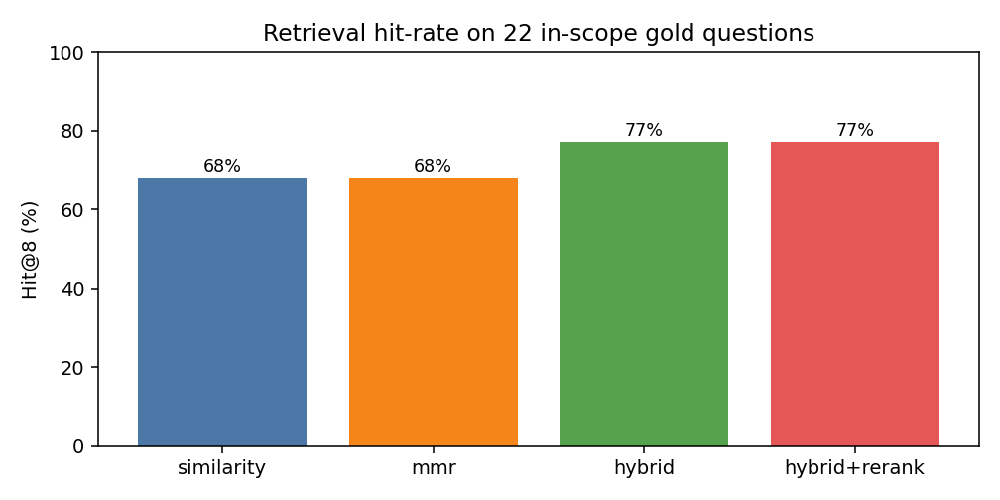

<h1>Multi-Doc RAG Q&amp;A with Citations</h1>

  
  
  
  
  
  
  
  
  

<blockquote><em>Upload PDFs, ask questions, get answers that cite the file and page they came from.</em></blockquote>

<h2>Overview</h2>

Reading long PDFs to find one fact is slow, and a plain chatbot will make an answer up. This app answers only from the documents you upload, numbers every claim back to the retrieved chunk, and says <em>"I don't know based on the provided context."</em> when the answer is not there.

Retrieval is measured on a labelled gold set (below). Answer faithfulness has a judge script but no published score yet.

<h2>Live demo</h2>

<a href="https://projects-wktkeuxu6u3nqmz9vdyith.streamlit.app/">projects-wktkeuxu6u3nqmz9vdyith.streamlit.app</a>

Upload a PDF (text-based or scanned) and ask a question. No login required.

<h2>What it does</h2>

<ul>
  <li>Upload 1–10 PDFs in the Streamlit sidebar (<code>MAX_PDFS = 10</code>).</li>
  <li>Text is extracted per page with pdfplumber. Pages with no text fall back to Tesseract OCR.</li>
  <li>Pages are chunked (1,000 chars, 200 overlap), embedded with all-MiniLM-L6-v2, and stored in a persistent Chroma collection. Re-uploading a file replaces its old chunks.</li>
  <li>Questions go through hybrid search (vector cosine weight 0.6 + BM25 0.4). Similarity and MMR are also selectable.</li>
  <li>Optional cross-encoder rerank (<code>ms-marco-MiniLM-L-6-v2</code>) re-scores the top 20 candidates and keeps the top 8. It is on by default when the model loads, and can be toggled in the sidebar.</li>
  <li>Out-of-scope gate: if the best score is below the floor (or the cross-encoder logit is below −9.0 with rerank on), no context is passed and the app refuses instead of guessing.</li>
  <li>The LLM answers from the numbered context only and cites it as <code>[1]</code>, <code>[2]</code>. Each source is shown as <code>filename, p.N</code>.</li>
  <li>FastAPI wrapper for programmatic use: <code>GET /health</code>, <code>POST /ingest</code>, <code>POST /ask</code> (with <code>method</code> and <code>use_reranker</code>).</li>
</ul>

<pre><code>PDFs → pdfplumber (OCR fallback) → chunk 1000/200 → MiniLM → Chroma
question → hybrid (vector + BM25) → [cross-encoder rerank 20 → 8] → OOS gate → LLM → answer + [N] citations
</code></pre>

<h2>Results</h2>

Retrieval eval on a 24-question gold set (22 in-scope + 2 out-of-scope) over two public arXiv papers (Vaswani et al. <em>Attention Is All You Need</em>; Lewis et al. <em>RAG</em>).
Run: 27 Oct 2026 (IST) · full arXiv PDFs (132 chunks) · MiniLM embeddings · hybrid weight 0.6 ·
<code>cross-encoder/ms-marco-MiniLM-L-6-v2</code> rerank on CPU (top 20 → 8) · cross-encoder logit floor −9.0 for out-of-scope.

<table>
  <thead>
    <tr><th>Method</th><th>Hit@8</th><th>MRR</th><th>Hits</th><th>OOS refused</th></tr>
  </thead>
  <tbody>
    <tr><td>Cosine similarity</td><td>68.2%</td><td>0.406</td><td>15/22</td><td>0/2</td></tr>
    <tr><td>Similarity + rerank</td><td>72.7%</td><td>0.499</td><td>16/22</td><td>2/2</td></tr>
    <tr><td>MMR</td><td>68.2%</td><td>0.411</td><td>15/22</td><td>0/2</td></tr>
    <tr><td>MMR + rerank</td><td>68.2%</td><td>0.534</td><td>15/22</td><td>2/2</td></tr>
    <tr><td>Hybrid (BM25 + vector)</td><td>77.3%</td><td>0.412</td><td>17/22</td><td>0/2</td></tr>
    <tr><td><strong>Hybrid + rerank (default when the model loads)</strong></td><td><strong>77.3%</strong></td><td><strong>0.524</strong></td><td><strong>17/22</strong></td><td><strong>2/2</strong></td></tr>
  </tbody>
</table>

Hit@8 = at least one retrieved chunk's page matches the gold page. MRR = mean reciprocal rank of the first gold-page hit.
Rerank keeps hybrid Hit@8 at 17/22, lifts MRR from 0.412 to 0.524, and makes out-of-scope refusal 2/2 (from 0/2).
Full table: <a href="eval/results.md"><code>eval/results.md</code></a> · raw: <a href="eval/results.json"><code>eval/results.json</code></a>.

Unit tests: <code>python -m pytest tests/ -q</code> → 62 passed, no API keys (run 27 Oct 2026 on the merged code). The tests use the small sample PDFs in <code>data/sample_pdfs/</code>; the eval table above used the full arXiv PDFs in <code>data/arxiv_pdfs/</code> (gitignored, download steps in <a href="data/README.md"><code>data/README.md</code></a>).

<h2>Tech stack</h2>

<table>
  <thead>
    <tr><th>Layer</th><th>Tools</th></tr>
  </thead>
  <tbody>
    <tr><td>Language</td><td>Python 3.11</td></tr>
    <tr><td>Orchestration</td><td>LangChain 0.3.7</td></tr>
    <tr><td>Vector DB</td><td>Chroma 0.5.20 (persistent)</td></tr>
    <tr><td>Embeddings</td><td>sentence-transformers all-MiniLM-L6-v2 via langchain-huggingface (384-dim, runs locally)</td></tr>
    <tr><td>Hybrid search</td><td>rank-bm25 + vector cosine (vector weight 0.6)</td></tr>
    <tr><td>Reranker</td><td>cross-encoder/ms-marco-MiniLM-L-6-v2 (CPU, optional)</td></tr>
    <tr><td>LLM</td><td>Groq <code>openai/gpt-oss-120b</code> (default) or any OpenAI-compatible server (llama.cpp, Ollama, LM Studio)</td></tr>
    <tr><td>PDF parsing</td><td>pdfplumber 0.11.4</td></tr>
    <tr><td>OCR fallback</td><td>Tesseract + pytesseract + pdf2image</td></tr>
    <tr><td>Web UI</td><td>Streamlit 1.40.1</td></tr>
    <tr><td>REST API</td><td>FastAPI (/health, /ingest, /ask)</td></tr>
    <tr><td>Eval / tests</td><td>Gold-set Hit@k + MRR (<code>eval/run_eval.py</code>), LLM-as-judge script (<code>eval/run_faithfulness.py</code>), pytest (62 tests, no API keys) in GitHub Actions</td></tr>
    <tr><td>Deployment</td><td>Streamlit Community Cloud (<code>packages.txt</code> installs Tesseract + poppler)</td></tr>
  </tbody>
</table>

<h2>How to run</h2>

<pre><code># Clone the Projects repo
git clone https://github.com/MacAns-117/Projects.git
cd Projects/GenAi_Projects/Rag_Document_QA

# Python 3.11 virtual env
python3.11 -m venv .venv
source .venv/bin/activate          # Windows: .venv\Scripts\activate
python -m pip install -r requirements.txt
# OCR fallback also needs the Tesseract and poppler system packages (see packages.txt)

# Add your Groq API key (or use a local model, below)
cp .env.example .env               # then set GROQ_API_KEY (free key at console.groq.com)

# Streamlit UI
streamlit run app.py

# Or the FastAPI server (/health, /ingest, /ask)
uvicorn api:app --reload

# Retrieval eval (no LLM key). Download the two arXiv PDFs first to reproduce the table:
#   see data/README.md (it falls back to data/sample_pdfs/ otherwise)
python -m eval.run_eval

# Faithfulness / OOS judge (needs Groq or a local LLM_* server; not run for this commit)
# python -m eval.run_faithfulness

# Tests (no API keys)
python -m pytest tests/ -q</code></pre>

<h2>Run with a local model (llama.cpp / Ollama / LM Studio)</h2>

Groq is the default and nothing changes if you leave the <code>LLM_*</code> variables unset (the hosted demo keeps using Groq). Set <code>LLM_PROVIDER=openai_compatible</code> to send every chat call to any server that speaks the OpenAI Chat Completions API instead. The provider switch lives in <code>src/llm.py</code>.

<pre><code># 1. Start a server (pick one)
#    llama.cpp:  llama-server -m /path/to/model.gguf --alias my-model --port 8080 -c 32768 --jinja
#                (--jinja is the default in current builds; older builds need it for tool calls)
#    Ollama:     ollama serve            -> LLM_BASE_URL=http://localhost:11434/v1, LLM_MODEL=&lt;ollama tag&gt;
#    LM Studio:  start the local server  -> LLM_BASE_URL=http://localhost:1234/v1

# 2. Point the app at it (or put these in .env)
export LLM_PROVIDER=openai_compatible
export LLM_BASE_URL=http://localhost:8080/v1
export LLM_MODEL=my-model           # required; `curl $LLM_BASE_URL/models` lists names
# export LLM_API_KEY=...            # only if your server checks a key; a dummy is sent otherwise
# export LLM_MAX_TOKENS=8192        # optional; raise it for "thinking" models
# export LLM_TIMEOUT=600            # optional, seconds (default 300)
streamlit run app.py
# generation + faithfulness judge both use the LLM_* vars:
# python -m eval.run_faithfulness</code></pre>

<ul>
  <li>Not benchmarked locally. Retrieval numbers (Hit@k, MRR) do not depend on the LLM at all. Embeddings and the reranker already run locally. Answer quality does depend on the model, so measure your local model with <code>python -m eval.run_faithfulness</code> before quoting anything.</li>
  <li>Thinking models. Reasoning tokens count against the output cap. llama-server normally returns them in a separate <code>reasoning_content</code> field, and the app strips any <code>&lt;think&gt;…&lt;/think&gt;</code> block left in the answer. If replies come back empty or cut off, raise <code>LLM_MAX_TOKENS</code> or turn thinking off (for example <code>llama-server --reasoning-budget 0</code>).</li>
  <li>Plain prompt, no tools. RAG generation is a single prompt per question, so it is the least sensitive of the three apps to the model choice. Citations and the "I don't know" refusal are still prompt instructions, and smaller models follow them less reliably.</li>
  <li>Judge override. <code>OPENAI_BASE_URL</code>, <code>OPENAI_API_KEY</code> and <code>JUDGE_MODEL</code> still work as judge-only overrides (for example, generate locally and judge with a different model).</li>
  <li>Hosted demo. An app on Streamlit Cloud cannot reach <code>localhost</code> on your PC. Use local mode when you run the app on your own machine.</li>
</ul>

<h2>Project structure</h2>

<pre><code>Rag_Document_QA/
├── app.py                          # Streamlit UI (multi-PDF upload, method + rerank toggle, chat)
├── api.py                          # FastAPI wrapper (/health /ingest /ask)
├── src/
│   ├── config.py                   # Chunk size, top_k, score floors, model names, weights
│   ├── pdf_loader.py               # Page-level PDF text with OCR fallback
│   ├── chunker.py                  # RecursiveCharacterTextSplitter (1000 chars, 200 overlap)
│   ├── embeddings.py               # all-MiniLM-L6-v2 (cached)
│   ├── vectorstore.py              # Persistent Chroma DB with replace-on-reingest
│   ├── retriever.py                # Hybrid / MMR / similarity + OOS gates
│   ├── reranker.py                 # Optional ms-marco MiniLM cross-encoder (fails open)
│   ├── llm.py                      # Provider switch: Groq (default) or OpenAI-compatible
│   └── chain.py                    # Retrieve → prompt → answer with [N] citations or refusal
├── eval/
│   ├── gold_qa.json                # 24 labelled questions on 2 arXiv papers
│   ├── run_eval.py                 # Hit@k + MRR, with and without rerank (no LLM key)
│   ├── faithfulness.py             # LLM-as-judge helpers (OpenAI-compatible)
│   ├── run_faithfulness.py         # Answer groundedness + OOS refusal eval
│   ├── FAITHFULNESS_STATUS.md      # Why there is no faithfulness score yet
│   ├── results.md / results.json   # Measured retrieval table
│   └── figures/hit_at_8.png        # Chart of the table above
├── tests/                          # 62 tests: loader, chunker, retriever, rerank, OOS,
│                                   #   prompt rules, gold file, faithfulness (mocked), LLM provider
├── notebooks/exploration.ipynb     # Reloads eval/results.json
├── data/
│   ├── sample_pdfs/                # Small fixtures for tests (see data/README.md)
│   ├── uploaded_pdfs/              # Runtime uploads (gitignored)
│   └── README.md
├── .env.example                    # Variable names only, no secrets
├── requirements.txt
├── packages.txt                    # Tesseract + poppler-utils for Streamlit Cloud
├── pytest.ini
├── LICENSE                         # MIT
└── README.md</code></pre>

<h2>Limitations</h2>

<ul>
  <li>Hit@8 is retrieval-only. It measures whether the right page appears in the top-8 chunks, not whether the LLM's answer is correct. Answer faithfulness is a separate script (<code>python -m eval.run_faithfulness</code>) against any OpenAI-compatible endpoint; it is not run in CI and has no published score for this commit (see <a href="eval/FAITHFULNESS_STATUS.md"><code>eval/FAITHFULNESS_STATUS.md</code></a>).</li>
  <li>Hybrid (+rerank) still misses 5 in-scope questions on this gold set (tables / obscure lines). Rerank improved MRR; Hit@8 on hybrid stayed 17/22.</li>
  <li>Reranker is optional and CPU-sized (ms-marco-MiniLM-L-6-v2). If the model fails to load, the app fails open to unre-ranked hybrid. Toggle in the Streamlit sidebar; <code>use_reranker</code> on <code>POST /ask</code>.</li>
  <li>OOS refusal needs the cross-encoder path (CE logit floor). Without rerank, hybrid alone still returns chunks for the 2 OOS questions (0/2); with rerank it is 2/2.</li>
  <li>Streamlit Cloud is ephemeral. The vector DB doesn't persist across reboots, so users re-upload PDFs each session. Prefer leaving rerank off on very small Cloud instances if memory is tight.</li>
  <li>Not a hosted document product. This is a portfolio RAG, not a production system. No auth, no rate limiting, no monitoring, and no durable storage on the hosted demo.</li>
</ul>

<h2>License</h2>

Code is MIT (<a href="LICENSE"><code>LICENSE</code></a>). The arXiv papers used for eval are not shipped; download them per <a href="data/README.md"><code>data/README.md</code></a>.

